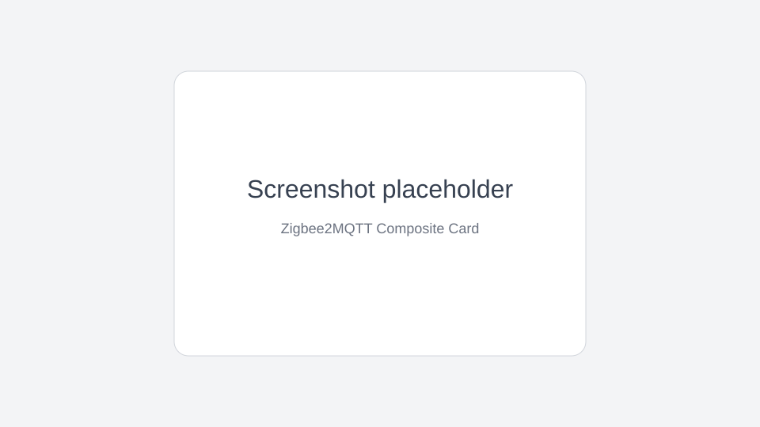

# Zigbee2MQTT Composite Card

A Home Assistant custom Lovelace card for editing Zigbee2MQTT **atomic composite** exposes, such as SONOFF irrigation settings, from the Home Assistant UI.



## What it does

Zigbee2MQTT composite exposes must be written as one complete object. This card reads the composite schema and current value from a stock Home Assistant `sensor` entity attribute named `z2m_composite`, renders an editor, and publishes one MQTT message containing the full composite object when you press **Save**.

It works on stock Home Assistant with only this card installed, but it requires the companion Zigbee2MQTT change that creates a composite sensor entity with the `z2m_composite` attribute.

Any settable composite is supported (the card is fully schema-driven). Verified against the SONOFF smart water valve composites, including the **manual watering** settings (`manual_default_settings`) and the **cyclic timed / quantitative irrigation** composites. For a brand-new/empty composite it seeds every field from the schema (numeric → minimum, enum → first option, binary → off, text → empty) so a complete payload can always be sent.

## Installation

### HACS custom repository

1. In HACS, add this repository as a custom repository.
2. Select category **Lovelace**.
3. Install **Zigbee2MQTT Composite Card**.
4. Add the Lovelace resource if HACS does not add it automatically:

```yaml
url: /hacsfiles/z2m-composite-card/z2m-composite-card.js
type: module
```

### Manual

1. Copy `dist/z2m-composite-card.js` to your Home Assistant `www/` directory.
2. Add it as a Lovelace resource:

```yaml
url: /local/z2m-composite-card.js
type: module
```

## Configuration

```yaml
type: custom:z2m-composite-card
entity: sensor.sonoff_irrigation_cyclic_timed_irrigation
title: Irrigation schedule
```

Options:

| Option | Required | Description |
| --- | --- | --- |
| `type` | yes | Must be `custom:z2m-composite-card`. |
| `entity` | yes | Home Assistant sensor entity that has the `z2m_composite` attribute. |
| `title` | no | Card title. Defaults to the Zigbee2MQTT schema label. |

## Expected entity attribute

The target sensor must expose:

```js
attributes.z2m_composite = {
  property: "cyclic_timed_irrigation",
  set_topic: "zigbee2mqtt/<device friendly name>/set",
  schema: { property: "...", label: "...", features: [ /* ... */ ] },
  value: { /* current complete composite object */ }
}
```

The card reads `schema` directly, renders fields for numeric, enum, binary, text, composite, and list features, then publishes:

```js
{
  "cyclic_timed_irrigation": {
    /* complete assembled object */
  }
}
```

to `set_topic` via Home Assistant's `mqtt.publish` service.

## Limitations

- The MQTT write is intentionally atomic: the card always sends the complete composite object because Zigbee2MQTT/device protocols cannot safely set individual composite sub-fields.
- The schema is read from entity attributes because Lovelace cards cannot read MQTT discovery or Zigbee2MQTT frontend internals directly.
- Nested composites are rendered recursively. List support is minimal: only the first list item is editable, while additional existing items are preserved when possible.

## Development

```bash
corepack pnpm install
corepack pnpm run build
```

The build outputs a single bundled ESM file at `dist/z2m-composite-card.js`.

## Attribution

The UI concept is inspired by the composite editor in the Zigbee2MQTT frontend (`nurikk/zigbee2mqtt-frontend`, `src/components/features/composite/*`). This project is an original Lit implementation and does not copy that source code.

## License

MIT © 2026 Maximilian Rink
